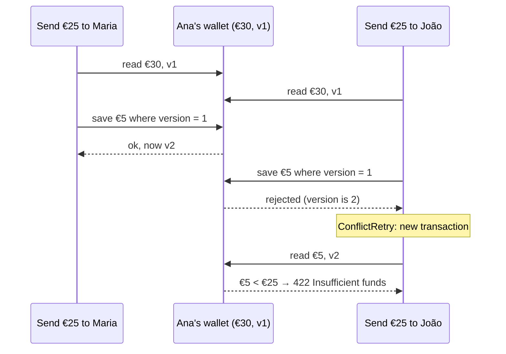

# Wallet

[](https://github.com/delciaa/wallet/actions/workflows/ci.yml)

A small payments backend in the style of Revolut, PayPal or MB Way: people sign up, top up a wallet, send money to each other and see their history, and an admin can freeze a wallet and check that every cent is accounted for.

The money is pretend. The behaviour isn't: the interesting part of this project is keeping balances correct when requests are **retried** or arrive **at the same moment**, which is where real payment systems break.

**Stack:** Java 21 · Spring Boot 4 · Spring Security (JWT) · Spring Data JPA · PostgreSQL 17 · Flyway · Testcontainers · GitHub Actions

---

## The two problems it solves

### 1. The double tap

Ana's connection is slow, so her phone sends "send €25 to Maria" twice. Without protection, Maria gets €50.

Every money-moving request carries an **`Idempotency-Key`** header: one value per user action, reused when the app retries that action. The server stores the key with the transfer (unique per user), so a repeat returns the original result instead of moving money again.

```
POST /api/transfers   Idempotency-Key: abc-123   → 201 Created     (money moves)
POST /api/transfers   Idempotency-Key: abc-123   → 200 OK          (same transfer, nothing moves)
                                                    Idempotent-Replayed: true
POST /api/transfers   Idempotency-Key: abc-123   → 422             (same key, different amount)
```

Two copies of the request can also arrive at the *same instant*. Both check "have I seen this key?", both see no, and both try to save. The database's `UNIQUE (initiated_by, idempotency_key)` constraint lets only one win; the other is retried, finds the winner's transfer, and replays it. Six simultaneous taps produce exactly one transfer (`TransferTests.simultaneousDoubleTapsSendExactlyOnce`).

### 2. Two requests at the same moment

Ana has €30 and sends €25 to two people at once. Both requests read "€30, enough", both subtract, and she ends up spending €50.

Wallets use **optimistic locking**: a `@Version` column that goes up on every change. A save only succeeds if the version is still the one the request read; otherwise it fails instead of overwriting, and `ConflictRetry` runs it again in a fresh transaction, where it sees the new balance.



**This is tested, and the tests catch the bug.** With `@Version` temporarily removed:

| Test | With `@Version` | Without it |
|---|---|---|
| 8 × €10 top-ups at once | €80 | **€10** (€70 lost) |
| €30, two €25 sends at once | one sent, one refused, €5 left | **both sent** |
| €100, twelve €25 sends at once | at most 4 sent | **more than €100 sent** |

---

## Design decisions

**Double-entry ledger.** Every movement of money is a `Transfer` that writes two ledger lines, one negative and one positive, so the whole ledger always sums to zero. A top-up is a transfer from a built-in `EXTERNAL` system wallet. `Transfer` can only be created through factory methods that always write a balanced pair, so an unbalanced transfer can't exist. Ledger lines are never updated or deleted.

**History comes from the ledger.** `GET /api/wallets/me/transactions` reads the caller's ledger lines, so history can never disagree with the balance, and a replayed double tap appears once.

**Reconciliation.** `GET /api/admin/reconciliation` checks that the ledger sums to zero and that every wallet's stored balance equals the sum of its ledger lines. All queries run in one `REPEATABLE_READ` transaction, so a transfer committing midway can't make a healthy ledger look broken. A test edits a balance directly in the database and checks the report flags exactly that wallet.

**No hot row.** The system wallet's stored balance is deliberately never updated: every user's top-up would otherwise update that one row and they'd all conflict. Its balance is the sum of its ledger lines instead.

**Deadlocks.** If Ana pays Maria while Maria pays Ana, two transactions can lock the same two rows in opposite orders. Hibernate is set to update rows in ID order (`order_updates`), so locks are always taken in the same order, and `ConflictRetry` also retries if PostgreSQL still reports a deadlock.

**Retries live outside the transaction.** A failed transaction can't be reused, so `*Service` classes (not transactional) run `*Transaction` classes (one transaction each) through `ConflictRetry`. Retrying inside the transaction would silently reuse a dead one.

**Freezing races too.** `Wallet.freeze()` bumps the version, so a transfer already in progress loses its race, is retried, and then sees the freeze.

**Cursor pagination.** History pages use a cursor (the last row's time and ID) rather than page numbers, so new transactions arriving while you scroll never repeat or skip rows.

**One application, not microservices.** All money movement happens inside single database transactions. Splitting wallets and transfers into separate services would turn that into a distributed transaction problem for no benefit at this size.

---

## Security

- **Passwords** are hashed with BCrypt. Inputs over BCrypt's 72-byte limit are rejected rather than silently truncated.
- **Login** returns a 15-minute HS256 JWT. A wrong password and an unknown email give the same `401 Invalid email or password` and take the same time (an unknown email is still checked against a dummy hash).
- **Users can only touch their own money.** The user always comes from the verified token, never from the request; there is no `?userId=` anywhere.
- **Admins** are a role in the token; `/api/admin/**` requires it. The first admin is the account named in `ADMIN_EMAIL`, promoted at startup after it signs up normally, so there is no default admin password.
- **Validation:** amounts must be 0.01–10,000.00 with at most two decimals (`@ValidAmount`), stored as `NUMERIC(19,2)` and handled as `BigDecimal`, never `double`.
- **Secrets** (`JWT_SECRET`, `ADMIN_EMAIL`) come from environment variables or a git-ignored `.env`. The app refuses to start without a JWT secret of at least 32 bytes.
- **Errors** are RFC 9457 `ProblemDetail` JSON, and none of them leak internals.

---

## API

| Method | Path | Auth | What it does |
|---|---|---|---|
| `POST` | `/api/auth/register` | none | Create an account with an empty €0 wallet |
| `POST` | `/api/auth/login` | none | Get a 15-minute access token |
| `GET` | `/api/me` | user | Your profile, balance and wallet status |
| `POST` | `/api/wallets/me/top-ups` | user + `Idempotency-Key` | Add pretend money |
| `POST` | `/api/transfers` | user + `Idempotency-Key` | Send money to another user by email |
| `GET` | `/api/wallets/me/transactions?limit=&cursor=` | user | Your history, newest first |
| `GET` | `/api/admin/wallets?email=` | admin | Find a user's wallet |
| `POST` | `/api/admin/wallets/{id}/freeze` | admin | Block all money in and out |
| `POST` | `/api/admin/wallets/{id}/unfreeze` | admin | Allow it again |
| `GET` | `/api/admin/reconciliation` | admin | Check that the numbers add up |

Example transfer:

```http
POST /api/transfers
Authorization: Bearer <token>
Idempotency-Key: 7f0c2d5e-...
Content-Type: application/json

{ "recipientEmail": "maria@example.com", "amount": 25.00 }
```

```json
{ "transferId": "29892a37-...", "type": "P2P", "amount": 25.00, "currency": "EUR", "createdAt": "2026-11-07T21:58:47Z" }
```

---

## Running it

You need Java 21 and Docker.

```bash
cp .env.example .env
# set JWT_SECRET to a long random value, for example:
openssl rand -base64 48

docker compose up -d          # PostgreSQL 17 on localhost:5434
./mvnw spring-boot:run        # app on localhost:8080
```

Flyway creates the tables on first start. To make yourself admin, set `ADMIN_EMAIL` in `.env`, register that email, and restart the app.

### Try it with Postman

Import [`postman/wallet.postman_collection.json`](postman/wallet.postman_collection.json). It walks through the whole story in order: sign up, top up, a double tap, a transfer, an overdraft attempt, history, then the admin folder. Logins save their tokens automatically, and every request checks its own response.

### Tests

```bash
./mvnw test
```

85 tests run against a real PostgreSQL started by Testcontainers (Docker must be running). They cover the HTTP API, security rules, double taps, the race conditions above, deadlock-prone opposite transfers, pagination stability and reconciliation. CI runs the same suite on every push.

---

## Project structure

```
src/main/java/io/github/delciaa/wallet/
├── auth/       sign-up and login
├── security/   JWT issuing and checking, access rules
├── user/       users and /api/me
├── wallet/     the Wallet entity: credit, debit, freeze
├── transfer/   top-ups, transfers, the ledger, idempotency
├── history/    paginated history from the ledger
├── admin/      freezing, reconciliation, first-admin setup
└── common/     ConflictRetry
```

Each error is its own exception class that knows its HTTP status and message. Services depend on interfaces where there's a reason to swap the implementation (`TokenService`).

---

## Not done yet

- **Audit log:** who froze a wallet, when and why.
- **Rate limiting:** for login attempts and transfers.
- **Field-level validation messages:** a `400` currently says "Invalid request content" without naming the field.
- **One currency:** everything is EUR; transfers between currencies are refused.
- **Recipient lookup:** `404 Recipient not found` reveals whether an email has an account, a trade-off most payment apps accept for clear feedback.
